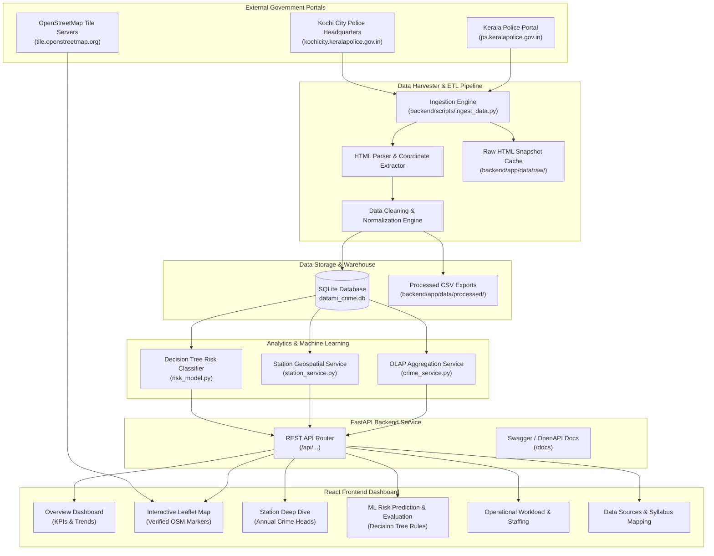

# DATAMI Architecture Documentation

## 1. System Overview

**DATAMI** (**D**ata-mining **A**nalytics and **T**emporal **A**ssessment for **M**etropolitan **I**ntelligence) is a specialized full-stack data mining and predictive analytics platform built for the **Kochi City Police Commissionerate** and surrounding Ernakulam jurisdictions (Kerala, India).

The project is structured specifically to meet the academic objectives of the **KTU S5 Data Mining Course (PECST525)**, translating core theoretical algorithms into an operational, fully reproducible software application.

---

## 2. Alignment with KTU S5 Data Mining Syllabus (PECST525)

| Syllabus Module                                 | Theoretical Concepts Covered                                                                                                                                                                  | Practical Implementation in DATAMI                                                                                                                                                                                                                                                                                                                                                   |
| ----------------------------------------------- | --------------------------------------------------------------------------------------------------------------------------------------------------------------------------------------------- | ------------------------------------------------------------------------------------------------------------------------------------------------------------------------------------------------------------------------------------------------------------------------------------------------------------------------------------------------------------------------------------ |
| **Module 1: Fundamentals & Warehousing**  | • KDD (Knowledge Discovery in Databases) Process• Multidimensional Data Model & Schemas• OLAP Operations (Roll-up, Drill-down, Slice, Dice)                                                | • Automated ETL harvester ingesting 14,000+ real records• Constellation warehouse schema (`crime_records` facts, `stations` & `staff_strength` dimensions)• Dynamic multidimensional filtering across Year $\times$ District $\times$ Station $\times$ Legal Category                                                                                                 |
| **Module 2: Data Preprocessing**          | • Data Cleaning (Handling missing values vs zero counts)• Concept Hierarchy Generation• Discretization & Numerosity Reduction                                                              | • Strict policy distinguishing true 0-count entries from unobserved years• Spatial hierarchy: District $\rightarrow$ Police Sub-Division $\rightarrow$ Station House• Legal hierarchy: System (IPC/SLL/BNS) $\rightarrow$ Category $\rightarrow$ Specific Crime Head• Discretization of continuous annual case counts into relative risk tiers                           |
| **Module 3: Classification & Evaluation** | • Decision Tree induction principles• Splitting Criteria: Gini Impurity & Information Gain• Algorithm: CART / ID3• Evaluation Measures: Accuracy, Precision, Recall, F1, Confusion Matrix | • scikit-learn`DecisionTreeClassifier` (`criterion='gini'`, max depth 3 for complete explainability)• Strictly chronological train/test split (Train: 2016–2019, Test: 2020–2025; no data leakage)• Lagged feature engineering ($T-1$, $T-2$, rolling 2-year average, registration velocity, SLL ratio)• Benchmarking against Zero-R and Persistence (Lag-1) baselines |
| **Module 4: Spatial & Pattern Analytics** | • Spatial Data Mining• Web Scraping & Data Extraction                                                                                                                                       | • Real-time OpenStreetMap tile mapping using Leaflet• Authentic geocoded police station markers parsed directly from official state portals                                                                                                                                                                                                                                        |

---

## 3. High-Level System Architecture Diagram

---

## 4. Multidimensional Data Model (OLAP Cube)

The central analytical engine treats historical crime statistics as a multidimensional data cube along four primary dimensions:

1. **Location Dimension ($D_{Location}$)**:
   - Level 0: State (Kerala)
   - Level 1: District (Ernakulam City vs. Ernakulam Rural)
   - Level 2: Sub-Division (Ernakulam, Mattancherry, Thrikkakara, Aluva, etc.)
   - Level 3: Station House (`station_id`, e.g. `ernakulamcentral`, `thrikkakara`)
2. **Time Dimension ($D_{Time}$)**:
   - Level 0: Era (Pre-COVID, Lockdown Period 2020–2021, Post-Lockdown 2022+)
   - Level 1: Year (2014 to 2025)
3. **Legal Classification Dimension ($D_{Law}$)**:
   - Level 0: Legal Code (IPC, Special & Local Laws, BNS)
   - Level 1: Aggregate Category (`IPC_TOTAL`, `SLL_TOTAL`, `ALL_TOTAL`)
   - Level 2: Crime Head (Murder, Robbery, Burglary, Theft, Hurt, Riots, NDPS, COTPA, etc.)
4. **Measures ($M$)**:
   - `case_count`: Number of registered First Information Reports (FIRs).
   - `cases_per_active_officer`: Incident-to-staff ratio.

### Supported OLAP Operations:

- **Slice**: Fixing one dimension (e.g. `year = 2021`).
- **Dice**: Defining sub-cubes across multiple dimensions (e.g. `district = 'Ernakulam'` AND `year IN (2019, 2020, 2021)` AND `crime_head = 'Theft'`).
- **Roll-up**: Aggregating station-level numbers into Sub-Division or District totals.
- **Drill-down**: Expanding from total IPC cases into specific offense heads like Hurt, Riots, or Burglary.

---

## 5. Technology Stack Rationale

- **Backend: Python 3.12+ & FastAPI**: Provides async performance, strict Pydantic type safety, and automatic OpenAPI documentation.
- **Persistence: SQLite**: Embedded, zero-configuration local database that guarantees atomic transactions without external database server overhead.
- **Data Mining: scikit-learn & Pandas**: Clean, auditable, and academically standardized implementations of the CART Decision Tree algorithm and confusion matrix metrics.
- **Frontend: React 18, TypeScript & Vite**: Fast development cycle, static typing, and modular component reusability.
- **Maps: Leaflet & OpenStreetMap**: Open-source, vendor-neutral web cartography respecting OSM tile usage policies with verified station marker placements.
- **Charts: Recharts**: Composable SVG charting optimized for React.
